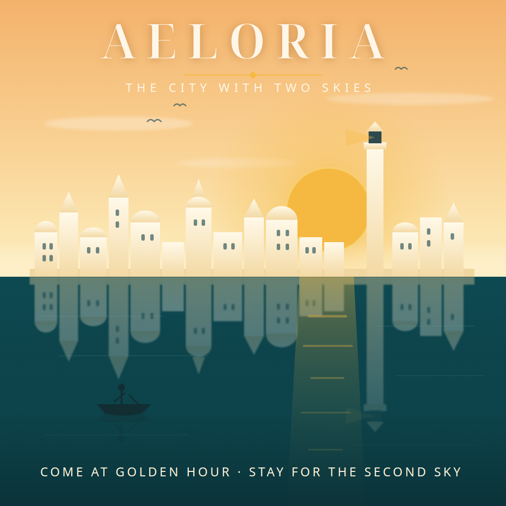

# AELORIA — The City with Two Skies

A travel poster for a place that does not exist: **Aeloria**, a lagoon city of
white towers where the water is so still the city has a perfect twin below the
surface — two skies, one above, one below. Come at golden hour.

## The poster

- **Place:** Aeloria, an invented lagoon city of white towers, domes, spires and
  one tall lighthouse.
- **Light:** golden hour — a huge low sun over a deep teal lagoon, warm peach
  sky, soft mist at the horizon.
- **Landmark:** the tower skyline and its mirror reflection, read as one
  composition — the city with two skies.
- **Scale:** one small dark rowing boat with a single figure, lower left.

## How it runs

`main.ts` (Node, stdlib only, no network) copies the pre-rendered `entry.png`
to `$MAKEFUN_OUTPUT_DIR/entry.png` (fallback `/output`). The poster itself was
built as HTML/SVG (`poster.html`) and rendered to PNG 1024×1024 with headless
Chromium.

## Entry

- Competition: [The Poster for a Place That Isn't There](https://make.fun/bounty/the-poster-for-a-place-that-i-2-20261121-0539)
- Program: `main.ts` — writes one image, `/output/entry.png` (PNG, 1024×1024, 244,882 bytes)
